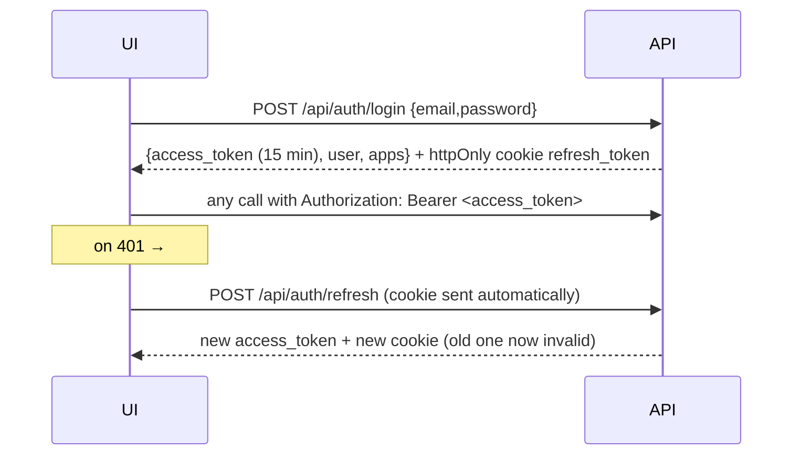
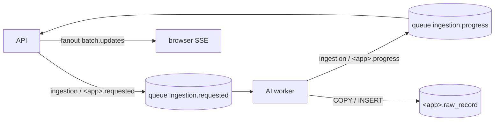

# API Guide — Reporting Studio backend

FastAPI · `backend/` · interactive docs at **http://localhost:8000/docs**

## Run

```powershell
cd backend
python -m venv .venv; .venv\Scripts\pip install -r requirements.txt
copy .env.example .env        # then set JWT_SECRET (DB settings come from db/.env)
.venv\Scripts\uvicorn app.main:app --reload --port 8000
.venv\Scripts\python -m pytest -q          # 14 end-to-end tests (needs built DB)
```

No `RABBITMQ_URL` → in-process broker (dev only). Set it to use real RabbitMQ.

### Smoke test of the running system
With the API on :8000 and RabbitMQ running:

```powershell
.venv\Scripts\python scripts\e2e_flow.py
```

What it does (re-runnable):
1. Creates 4 users, password `Azentio@123`, each with their role in ERP, AML and LENDING:

   | User | Role |
   |---|---|
   | appadmin@azentio.ai | APP_ADMIN |
   | reviewer@azentio.ai | REVIEWER |
   | analyst@azentio.ai | ANALYST |
   | viewer@azentio.ai | VIEWER |

2. Checks each user's dashboard cards, sidebar and permissions.
3. Runs the full ERP upload: the script plays the AI worker through RabbitMQ, the viewer watches over SSE, and the reviewer commits.
4. Cleans up its own leftover jobs from RabbitMQ.

`db/build.ps1 -Reset` deletes these users; re-run the script to recreate them.

### RabbitMQ (local)
- **Installed:** RabbitMQ 4.4.0 on Erlang 27.3.4.8, via Chocolatey.
- **Start:** `.\scripts\start-rabbitmq.ps1` (runs as a user process, see the note in the script).
- **AMQP:** `localhost:5672`, user `studio`, password in `backend/.env` → `RABBITMQ_URL`.
- **Management UI:** http://localhost:15672
- **Vhosts:** `/` for real work, `studio_test` for tests.
- **Run the tests through real RabbitMQ:**
  ```powershell
  $env:TEST_RABBITMQ_URL = 'amqp://studio:<pw>@localhost:5672/studio_test'; .venv\Scripts\python -m pytest -q
  ```

---

## Auth model



- **Access token:** keep it in memory only, never in localStorage.
- **Refresh token:** httpOnly, `SameSite=Strict` cookie on `/api/auth`, so JavaScript can't read it.
- **Same origin required:** use the Vite proxy (`/api` → `http://localhost:8000`) so the cookie works.

## Endpoints

| Method | Path | Body | Returns / notes |
|---|---|---|---|
| POST | `/api/auth/login` | `{email, password}` | `{access_token, user, apps}` · 401 bad creds · 423 locked · 403 disabled |
| POST | `/api/auth/refresh` | – (cookie) | `{access_token, user, app_code}` · 401 `{status}` (`TOKEN_REUSED` = theft, all sessions killed) |
| POST | `/api/auth/logout` | – | 204 |
| POST | `/api/auth/change-password` | `{old_password, new_password}` | other sessions revoked |
| GET | `/api/apps` | – | dashboard cards `[{code,name,description,icon,route,roles}]` |
| POST | `/api/apps/{app}/select` | – | `{app, roles, permissions[], sidebar[]}` · 403 no access |
| GET | `/api/apps/{app}/admin/users` | – | users + their roles in this app (needs `admin.users`) |
| POST | `/api/admin/users` | `{email, full_name, password, is_super_admin?}` | 201 `{user_id}` |
| POST | `/api/apps/{app}/admin/users/{id}/roles` | `{role}` | `{changed}` |
| DELETE | `/api/apps/{app}/admin/users/{id}/roles/{role}` | – | `{changed}` |
| PATCH | `/api/admin/users/{id}` | `{is_active}` | super admin only |
| POST | `/api/apps/{app}/batches` | multipart `file`, `source_system?`, `period_start?`, `period_end?` | 201 `{status:"CREATED", batch_id, batch_no}` · 200 `DUPLICATE` · 413 too big · 415 bad type/signature |
| GET | `/api/apps/{app}/batches?limit&offset` | – | batch list |
| GET | `/api/apps/{app}/batches/{id}` | – | batch + live `counts` |
| GET | `/api/apps/{app}/batches/{id}/events` | header `Last-Event-ID?` | **SSE** stream (below) |
| POST | `/api/apps/{app}/batches/{id}/commit` | – | `{status, received, accepted, rejected, loaded}` · 403 maker-checker |
| POST | `/api/apps/{app}/assistant/chat` | `{message, conversation_id?}` | Smart Assistance reply (below) · 403 no `assistant.use` · 404 not your conversation · 503 no `GROQ_API_KEY` |
| GET | `/api/health` | – | `{status, broker}` |
| POST | `/api/dev/progress` | worker progress JSON | **DEV only** (`DEV_ENDPOINTS=true`): fake the worker |

`{app}` = `erp` · `aml` · `lending`. Errors: `{"detail": ...}`; status codes from [DB_GUIDE § Errors](DB_GUIDE.md#errors).

### SSE stream

```
id: 42
event: progress
data: {"event_id":42,"batch_id":"…","app":"erp","status":"EXTRACTING","progress_pct":40,"message":"OCR 40%","created_at":"…"}
```
- Native `EventSource` can't send `Authorization`, so use a fetch-based client (e.g. `@microsoft/fetch-event-source`).
- On reconnect, send `Last-Event-ID` to get the missed events from the DB first.
- `: ping` comments arrive every 15 s. `event: session_ended` means log out.

---

## 💬 Smart Assistance

`POST /api/apps/{app}/assistant/chat` with `{"message": "...", "conversation_id": "<from the last reply, optional>"}`.

```json
{"conversation_id": "uuid", "status": "answered|clarification|refused|error",
 "answer": "text for the user", "tool_name": "get_erp_payables_ageing", "grounded": true,
 "sources": {"result_reference": "uuid", "reporting_period": "As of 2026-10-31", "filters": {}, "metric_definitions": []},
 "result": {"kpis": {}, "chart_data": [], "supporting_rows": [], "...": "full tool result"}}
```

- **`clarification`:** send the user's reply with the same `conversation_id`. The original question is remembered.
- **`grounded: false`:** the AI summary contained a number that isn't in the tool result, so the server replaced it with a plain summary of the KPIs.
- **How it works:** `backend/app/assistant/` (LangGraph) plans with Groq, validates the plan, runs one tool from `db/07_smart_assistance.sql` as `<app>_app`, then answers only from that result. Every question is audited in `<app>.assistant_audit`.

---

## 🤖 AI worker contract (for the ML side)

Implemented in [`worker/`](../worker/README.md) (`python -m ai_worker`).



**1. Consume** queue `ingestion.requested` (durable). Message body:
```json
{"batch_id":"uuid","app":"erp","file_type":"CSV|EXCEL|JSON|PDF","file_name":"payables.csv",
 "storage_uri":"file:///E:/Hackathon/backend/storage/erp/<sha256>.csv","sha256":"…","uploaded_by":"uuid"}
```

**2. Report progress:** publish to exchange `ingestion` (topic), routing key `<app>.progress`:
```json
{"batch_id":"uuid","app":"erp","status":"EXTRACTING","progress_pct":40,"message":"OCR page 2/5"}
```
- Allowed status path: `EXTRACTING` → `MAPPING_REVIEW` → `VALIDATING` → `READY_TO_COMMIT`.
- Any step may go to `NEEDS_REVIEW`, or to `FAILED` (add `"error":"..."`).
- An illegal jump is rejected, and the message goes to queue `ingestion.dead`.

**3. Write records** to `<app>.raw_record` by connecting as `<app>_app` (password in `db/.env`). Use `COPY` for bulk.

| column | value |
|---|---|
| `batch_id`, `record_no` | batch + 1..n |
| `target_entity` | domain table name, e.g. `invoice` |
| `source_location` | `{"sheet":"Payables","row":12}` or `{"page":2,"table":1,"row":4,"bbox":[…]}` |
| `raw_fields` | original names → values, untouched |
| `normalized_fields` | keys = domain column names (see DB_GUIDE § Domain tables) |
| `extraction_method` | `csv` `excel` `json` `pdf_text` `ocr` |
| `confidence` | 0–1 or null |
| `state` | `PENDING` / `ACCEPTED` / `REJECTED` / `NEEDS_REVIEW` |

Optional: write `mapping_version` (AI proposals, `created_by` NULL) and `validation_issue` rows.

**4. Commit:** the worker never commits. A REVIEWER commits from the UI.
