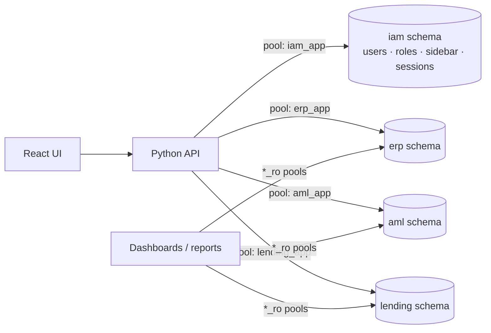
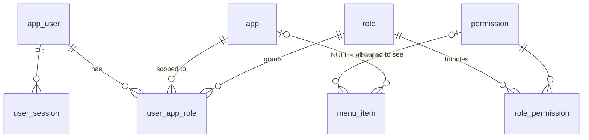
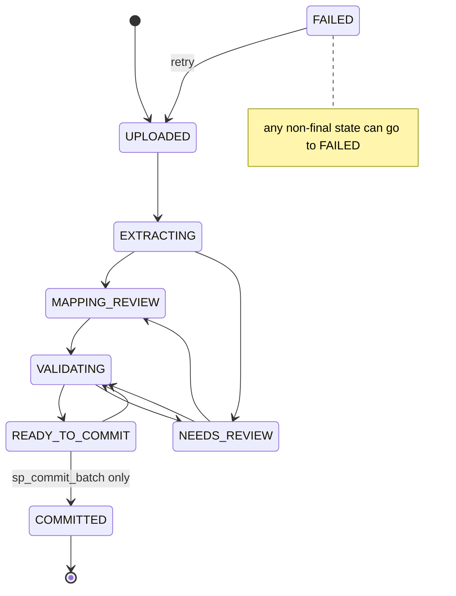
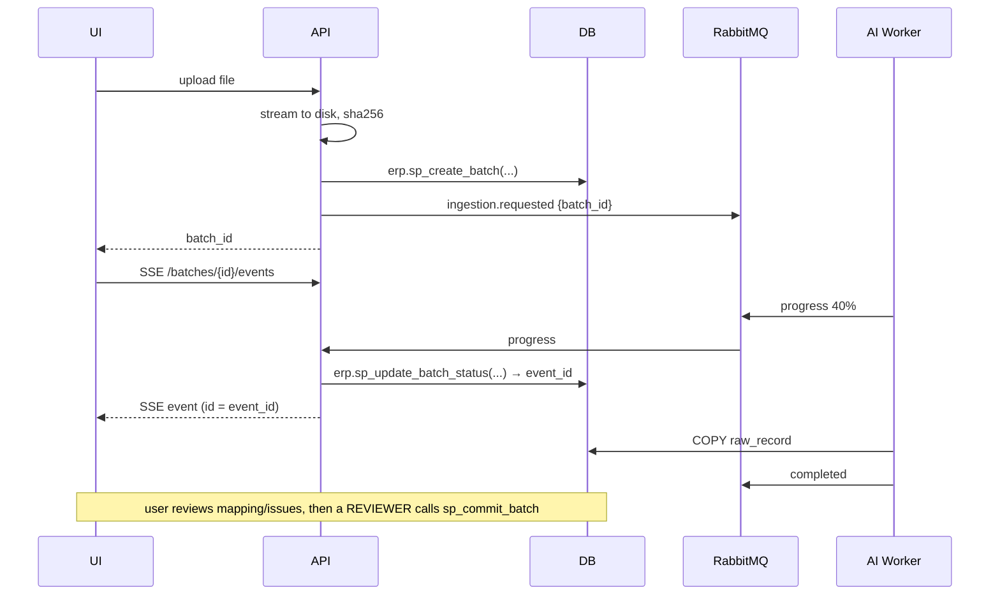

# Database Guide — Reporting Studio

PostgreSQL 16 · database `reporting_studio` · scripts in [`db/`](../db)

> **TL;DR for the backend:** never write SQL against `iam` tables. Call the functions.
> Every function returns JSON or a scalar; errors come back as SQLSTATE codes (see [Errors](#errors)).

---

## 1. Big picture



| Schema | Holds | Backend connects as |
|---|---|---|
| `iam` | users, roles, permissions, apps, sidebar, sessions, audit | `iam_app` (EXECUTE on functions only, **no table access**) |
| `erp` / `aml` / `lending` | upload pipeline + that product's business tables | `<schema>_app` (read/write) and `<schema>_ro` (read-only) |

Role passwords are in `db/.env` (git-ignored, generated by `build.ps1`).
`erp_app` **cannot** read `aml`, `lending` or `iam` — PostgreSQL itself blocks it.

---

## 2. How to build / test

```powershell
$env:PGPASSWORD = '<postgres password>'
.\db\build.ps1 -Reset      # drop + create everything + run tests
.\db\build.ps1 -TestOnly   # only re-run tests (they roll back, no leftovers)
```

| File | What it does |
|---|---|
| `00_roles_and_database.sql` | 7 login roles + the database |
| `01_schemas.sql` | extensions (pgcrypto, citext), 4 schemas, connect rights |
| `02_iam_tables.sql` | RBAC tables |
| `03_iam_functions.sql` | auth / RBAC / user-admin functions + grants |
| `04_product_pipeline.sql` | includes `_product_pipeline.sql` once per product |
| `_product_pipeline.sql` | template: pipeline tables + functions for one product |
| `05_domain_tables.sql` | business tables (invoice, alert, application…) |
| `06_seed.sql` | apps, roles, permissions, sidebar, demo users |
| `tests/test_all.sql` | 13 test groups (auth, RBAC, sidebar, sessions, pipeline, role isolation) |

**Demo users** (password is in `06_seed.sql`):

| Email | Access | Dashboard cards |
|---|---|---|
| admin@studio.local | Super admin | ERP, AML, Lending |
| manager@studio.local | REVIEWER in all 3 | ERP, AML, Lending |
| associate@studio.local | ANALYST in ERP, AML | ERP, AML |
| viewer@studio.local | VIEWER in Lending | Lending |
| erpadmin@studio.local | APP_ADMIN in ERP | ERP |

---

## 3. RBAC model



- **Roles are per app.** Same person can be ANALYST in ERP and VIEWER in Lending.
- **Code checks permissions, never role names** → `fn_has_permission(user, 'ERP', 'batch.commit')`.
- **Changing who sees what = changing rows**, not code.

### Role → permission matrix

| Permission | VIEWER | ANALYST (maker) | REVIEWER (checker) | APP_ADMIN |
|---|:-:|:-:|:-:|:-:|
| dashboard.view, dataset.view, report.view, report.generate, template.view, assistant.use | ✅ | ✅ | ✅ | ✅ |
| dataset.upload | | ✅ | | ✅ |
| mapping.review, data_quality.review | | ✅ | ✅ | ✅ |
| template.edit | | ✅ | | ✅ |
| batch.commit, template.approve | | | ✅ | ✅ |
| admin.users | | | | ✅ |

Super admin (`app_user.is_super_admin`) = every permission in every app.

### Sidebar (shared by all apps, filtered per user)

| Menu | Needs | Children |
|---|---|---|
| Dashboard | dashboard.view | |
| Datasets | dataset.view | All batches (dataset.view), Upload file (dataset.upload) |
| Mapping Review | mapping.review | |
| Data Quality | data_quality.review | |
| Reports | report.view | |
| Templates | template.view | |
| Smart Assistance | assistant.use | |
| Administration | admin.users | Users & roles |

---

## 4. `iam` tables

| Table | Purpose | Key columns |
|---|---|---|
| `app` | Products = dashboard cards | `code` (ERP/AML/LENDING), `route`, `icon`, `schema_name` |
| `app_user` | Accounts | `email` (case-insensitive, unique), `password_hash` (bcrypt), `is_super_admin`, `is_active`, `failed_login_count`, `locked_until` |
| `role` | APP_ADMIN, REVIEWER, ANALYST, VIEWER | `code` |
| `permission` | `area.action` codes | `code` |
| `role_permission` | Role → permissions | PK (role, permission) |
| `user_app_role` | **The grant**: user has role in app | PK (user, app, role) |
| `menu_item` | Sidebar entries, max 2 levels | `app_id` NULL = all apps, `parent_id`, `route`, `required_permission_id` |
| `user_session` | One row per refresh token | `refresh_token_hash` (sha256 only), `app_id` (selected app), `expires_at`, `revoked_at`, `revoke_reason` |
| `audit_log` | Security trail | `actor_user_id`, `action`, `target_*`, `details` jsonb |

---

## 5. `iam` functions (call as `iam_app`)

`sp_` = changes data · `fn_` = read only.

### Auth & SSO

| Function | Returns | Notes |
|---|---|---|
| `sp_login(email, password, ip?, user_agent?)` | `{status, user, session{session_id, refresh_token, expires_at}, apps}` | status: `OK` · `INVALID_CREDENTIALS` · `ACCOUNT_LOCKED` · `ACCOUNT_DISABLED`. 5 bad tries → locked 15 min |
| `sp_select_app(session_id, app_code)` | `{status, app, roles, permissions, sidebar}` | user clicked a card. status: `OK` · `FORBIDDEN` · `SESSION_INVALID` |
| `sp_refresh_session(refresh_token, ip?, ua?)` | `{status, user, session, app_code}` | rotates token. `TOKEN_REUSED` = old token replayed → **all** user sessions killed |
| `sp_logout(session_id)` | boolean | |
| `fn_session_is_active(session_id)` | boolean | call per request → logout/disable is instant |
| `sp_change_password(user_id, old, new, keep_session_id?)` | `{status}` | revokes other sessions |

### RBAC reads

| Function | Returns | Used for |
|---|---|---|
| `fn_has_permission(user_id, app_code, permission)` | boolean | **every protected API call** |
| `fn_get_user_permissions(user_id, app_code)` | text[] | show/hide buttons |
| `fn_get_user_apps(user_id)` | `[{code, name, description, icon, route, roles}]` | dashboard cards |
| `fn_get_sidebar(user_id, app_code)` | `[{code, label, route, icon, children[]}]` | sidebar |

### User admin (needs `admin.users` in that app, or super admin)

| Function | Returns | Rule |
|---|---|---|
| `sp_create_user(actor, email, full_name, password, is_super_admin=false)` | user_id | app admin can't create super admins |
| `sp_assign_role(actor, user_id, app_code, role_code)` | boolean (false = already had it) | |
| `sp_revoke_role(actor, user_id, app_code, role_code)` | boolean | |
| `sp_set_user_active(actor, user_id, active)` | void | super admin only; disabling kills sessions, enabling clears lock |
| `fn_list_users(actor, app_code)` | `[{user_id, email, full_name, is_active, locked, roles…}]` | admin screen |

Password policy: ≥ 8 chars, a letter and a digit.

---

## 6. Product schemas (`erp`, `aml`, `lending` — identical pipeline)

### Batch life cycle



### Pipeline tables

| Table | Purpose |
|---|---|
| `ingestion_batch` | One uploaded file: status, progress, checksum (`sha256`), `storage_uri` (file lives on disk, not in DB), final counts, who uploaded / committed |
| `batch_event` | Every status/progress change → SSE stream + replay on reconnect |
| `raw_record` | One extracted candidate record: `raw_fields` (original, never changed), `normalized_fields` (after mapping), `source_location`, `target_entity`, `state` (PENDING / ACCEPTED / REJECTED / NEEDS_REVIEW) |
| `mapping_version` | AI-proposed / human-approved field mappings, versioned |
| `validation_issue` | Data-quality issue per record/field with original + corrected value |
| `template_version` | Report/document templates, versioned; DB blocks approver = creator |
| `report_run` | Every generated output with filters, period, batches, template version |

### Pipeline functions (call as `<schema>_app`)

| Function | Returns | Rules |
|---|---|---|
| `sp_create_batch(user_id, file_name, file_type, size, sha256, storage_uri, mime?, source_system?, period_start?, period_end?)` | `{status: CREATED/DUPLICATE, batch_id, batch_no}` | needs `dataset.upload`; same checksum already live → `DUPLICATE` (no double import) |
| `sp_update_batch_status(batch_id, status, pct?, message?, error?)` | event_id | called on each RabbitMQ progress msg; illegal jumps rejected |
| `sp_commit_batch(user_id, batch_id)` | `{status, received, accepted, rejected, loaded{entity: rows}}` | needs `batch.commit`; **uploader can't commit own batch**; no PENDING/NEEDS_REVIEW left; all-or-nothing |
| `fn_get_batch(user_id, batch_id)` | batch JSON + live `counts` | needs `dataset.view` |
| `fn_list_batches(user_id, limit=50, offset=0)` | list, newest first | needs `dataset.view` |
| `fn_get_batch_events(batch_id, after_event_id=0)` | rows | SSE replay (`Last-Event-ID`) |

**What `<schema>_app` can write directly:** `raw_record` (bulk `COPY`), `mapping_version`, `validation_issue`, `template_version`, `report_run`.
**Only through functions:** `ingestion_batch`, `batch_event`, all domain tables.

### Domain tables

| Schema | Tables (PK) |
|---|---|
| erp | `supplier` (supplier_id), `invoice` (invoice_id), `payment` (payment_id), `payment_allocation` (payment_id, invoice_id), `credit_note` (credit_note_id) |
| aml | `investigation_case` (case_id), `alert` (alert_id, case optional), `status_event` (event_ref) |
| lending | `application` (application_id), `disbursement` (disbursement_id), `application_status_event` (event_ref) |

Every domain row has `batch_id` + `source_record_no` → **click any number, find the exact file row**.

**How commit loads data:** for each ACCEPTED `raw_record`, `normalized_fields` (keys = column names of `target_entity`) becomes a typed row via `jsonb_populate_record`, upserted by primary key. Same business key in a later batch → **updated, not duplicated** (newer batch wins).

---

### Smart Assistance (`07_smart_assistance.sql`)

Per product, from the template `_assistant.sql`:

| Object | Purpose |
|---|---|
| `assistant_conversation` | context kept between turns (a pending clarification, the last 3 turns); only its owner can read it |
| `assistant_tool_run` | one row per data-tool call; its `run_id` is the `result_reference` shown to users |
| `assistant_audit` | one row per question: intent, tool, arguments, period, result reference, outcome |
| `sp_assistant_save_conversation`, `fn_assistant_get_conversation`, `sp_assistant_audit` | the only way to use the tables above |

**Data tools** (`fn_tool_*`, docs_ai/02 § Allowlisted data tools). Every tool:
- re-checks `assistant.use` and `dashboard.view`
- records the run
- returns `{result_reference, product, reporting_period, filters, metric_definitions, kpis, chart_data, supporting_rows}`

Money KPIs are always `{currency: amount}`, never summed across currencies.

| Schema | Tools |
|---|---|
| lending | `fn_tool_application_summary`, `fn_tool_application_details`, `fn_tool_application_trend` |
| erp | `fn_tool_payables_ageing`, `fn_tool_overdue_by_supplier`, `fn_tool_payment_details` (outstanding = invoice − allocations − approved credit notes, as of a date) |
| aml | `fn_tool_alert_summary`, `fn_tool_alert_details`, `fn_tool_case_details` |

**Existing databases:** apply it once as superuser:

```
psql -d reporting_studio -v ON_ERROR_STOP=1 -1 -f db/07_smart_assistance.sql
```

`build.ps1` includes it for new builds.

---

## 7. Upload flow (who calls what)



---

## Errors

| SQLSTATE | Meaning | HTTP |
|---|---|---|
| `42501` | not allowed (permission, maker-checker) | 403 |
| `22023` | bad input / illegal state change | 400 |
| `P0002` | not found | 404 |
| `23505` | duplicate (e.g. email) | 409 |
| `22P02`, `23503` | bad value / missing parent during commit | 422 |

Expected login outcomes (wrong password, locked…) are **not** errors — they come back as `{"status": ...}`.

## Adding a 4th product

1. `CREATE SCHEMA x;` + roles `x_app`, `x_ro` (in `00`/`01`)
2. Two lines in `04_product_pipeline.sql`: `\set schema x` / `\ir _product_pipeline.sql`
3. Domain tables in `05` (follow the rules at the top of that file)
4. One row in `iam.app`
