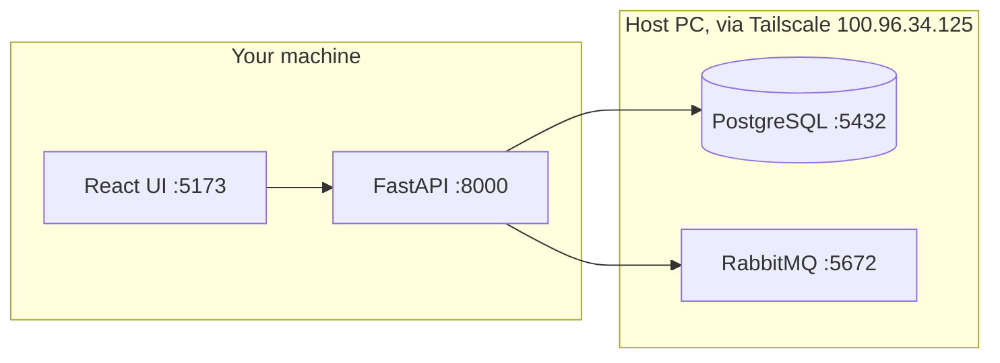

# Team setup: run the project on your machine

The **host PC** keeps the shared services running: PostgreSQL and RabbitMQ, reached over Tailscale.
You install **only the app code and its libraries**. You don't install PostgreSQL or RabbitMQ.



## 0. One-time: host PC (the person who owns the DB)

The host PC must be on and connected to Tailscale.

| Service | Status | What to do |
|---|---|---|
| PostgreSQL 5432 | Already shared | Nothing |
| RabbitMQ 5672 | Not shared yet | Run the command below |
| RabbitMQ UI 15672 | Optional | Run the command below |

In an admin PowerShell on the host:
```powershell
tailscale serve --bg --tcp 5672  tcp://localhost:5672
tailscale serve --bg --tcp 15672 tcp://localhost:15672
```
Start RabbitMQ after each reboot: `.\scripts\start-rabbitmq.ps1`

Give each teammate, **privately**: the contents of `db/.env` (app role passwords) and the RabbitMQ password from `backend/.env` (`RABBITMQ_URL`).

## 1. Install (teammate, once)

| Need | Version |
|---|---|
| Git | any |
| Python | 3.11 or newer |
| Node.js | 20 or newer |
| Tailscale | logged in, with the host machine shared to you |

```bash
git clone https://github.com/the-silent-geek/AI_reporting_and_configuration.git
cd AI_reporting_and_configuration
```

## 2. Configure

**db/.env**: copy `db/.env.example` to `db/.env`, then paste the host's values.
- `DB_HOST=100.96.34.125`
- the four `*_APP_PASSWORD` values come from the host's `db/.env`

**backend/.env**: copy `backend/.env.example` to `backend/.env`, then set:
```
JWT_SECRET=<generate your own>
RABBITMQ_URL=amqp://studio:<password>@100.96.34.125:5672/
```
Leave `RABBITMQ_URL` empty if you only work on the UI or the DB and don't need the real queue.

**Check the connections:**
```bash
psql "postgresql://teammate:<password>@100.96.34.125:5432/reporting_studio" -c "select count(*) from iam.app_user"
```

## 3. Run

```bash
# backend (terminal 1)
cd backend
python -m venv .venv
.venv\Scripts\pip install -r requirements.txt        # macOS/Linux: .venv/bin/pip
.venv\Scripts\uvicorn app.main:app --reload --port 8000

# frontend (terminal 2)
cd frontend
npm install
npm run dev                                            # http://localhost:5173
```

Sign in: `analyst@azentio.ai` / `Azentio@123` (also `reviewer@`, `viewer@`, `appadmin@`).
If those users don't exist yet, the host runs `backend/scripts/e2e_flow.py` once.

**UI only, no backend on your machine?** Point the UI at the host's API (the host runs it with `--host 0.0.0.0`):
```
# frontend/.env.local
VITE_API_TARGET=http://100.96.34.125:8000
```

## Rules for a shared database

- **Never run `db\build.ps1 -Reset`** against the shared DB: it drops everything for everyone. It is only for your own local DB.
- To change the schema, edit the `db/*.sql` files, agree on it in chat, and let the host apply it.
- **Run tests against your own DB or the test vhost.** Backend tests create their own users and files, but they do write rows to the shared DB. For RabbitMQ use `TEST_RABBITMQ_URL=amqp://studio:<pw>@100.96.34.125:5672/studio_test`.
- **Never commit `.env` files.** They are git-ignored; check `git status` before you push.

## Uploads and the AI worker

The API saves each uploaded file on **the disk of the machine running that API**, and sends the worker a `file://` path.
- **If the ML teammate's worker runs on a different machine than the API that received the upload, it cannot read the file.**
- Two ways to handle it:
  1. **One shared API** on the host PC (everyone's UI points at it with `VITE_API_TARGET`), and the worker runs on the host or reads a shared folder.
  2. **A download endpoint for the worker** in the API. This is a small change; ask for it before you wire up the real worker.

## Troubleshooting

| Symptom | Cause |
|---|---|
| `connection timed out` to `100.96.34.125` | Host is off, or Tailscale isn't connected on either side |
| `password authentication failed for user "erp_app"` | Wrong value in `db/.env` |
| `/api/health` returns 500 | `db/.env` missing or wrong host |
| `RabbitMQ ... connection refused` | Host hasn't run the `tailscale serve` for 5672, or RabbitMQ isn't started |
| Login works but you're logged out on refresh | UI and API on different origins: use the Vite proxy, not a direct API URL |
