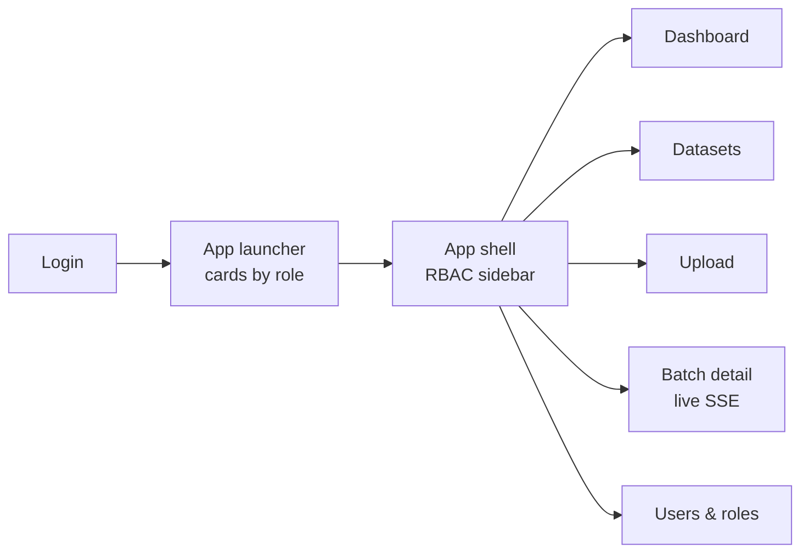
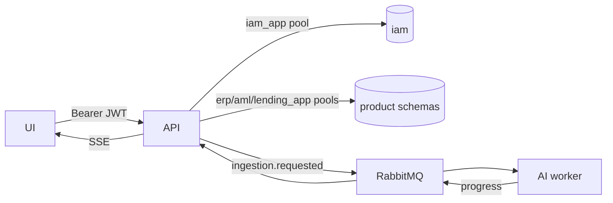

# WorkDone

Short log of what is built. Details → [DB_GUIDE.md](DB_GUIDE.md) · reasons → [Decisions.md](Decisions.md)

---

## 2026-10-31 · Frontend UI (React + Vite + Tailwind) ✅



**Built** (`frontend/`)
- **Look:** black and white design tokens, light/dark/system theme with no flash on load, Inter font bundled locally
- **Login:** brand panel on desktop; clear messages for wrong password, locked account and disabled account
- **Launcher:** one card per app the user has a role in, with role badges and staggered animation
- **Sidebar:**
  - collapses and expands with a spring animation (button or Ctrl+B); the choice is remembered
  - icon rail with tooltips when collapsed, sliding active highlight, animated sub-menus
  - app switcher at the top; a slide-in drawer on mobile
- **Pages:** dashboard (upload stats + recent uploads), datasets (filter, search, table on desktop and list on mobile)
- **Upload:** drag and drop, type and size checks, real upload progress bar, duplicate files open the existing batch
- **Batch detail:** progress stepper, live SSE progress and timeline, record breakdown bar, commit with confirm step (reviewers only)
- **Users & roles:** search, add user, roles dialog that saves only what changed, enable/disable for super admins
- **RBAC in the UI:** sidebar, buttons and routes follow the user's permissions; a typed URL to a forbidden page shows "no access"
- **Not built yet:** Mapping, Data quality, Reports, Templates and Assistant show an honest "not available yet" screen, not fake data

**Header update**
- The application switcher moved from the sidebar to the header, next to the page breadcrumb.
- Theme toggle (light/dark) added to the header; it was removed from the profile menu.
- Profile menu now has **Change password**: asks for the current password, then the new one twice, with live rule checks. The server signs out the other devices.
- Fixed: switching application sent you straight back to the previous one. The shell used the old app's context for one render and redirected; it now waits for the new app's context.
- Fixed: in dialogs, focus jumped back to the first field on every keystroke.

**Verified in the browser**
- Signed in as analyst, reviewer, app admin and viewer (`@azentio.ai`)
- Full run: upload → the worker runs through RabbitMQ → live SSE → reviewer commits (5 accepted, 1 rejected)
- Both themes, desktop and 375 px mobile
- `npm run build` is clean; lint has 0 errors and 17 style warnings

**Run**
```powershell
cd frontend; npm install; npm run dev     # http://localhost:5173 (proxies /api to :8000)
```

---

## 2026-10-31 · Backend API (FastAPI) ✅



**Built** (`backend/`, guide → [API_GUIDE.md](API_GUIDE.md))
- **Auth:** login, refresh with rotation (httpOnly cookie), logout, change password
- **SSO:** dashboard cards, select app (returns sidebar + permissions)
- **Admin:** list/create users, assign/revoke roles, enable/disable users
- **Upload:**
  - file streamed to disk while hashing
  - stored by content hash, so identical files are kept once
  - size limit and real file-signature check
  - duplicate upload returns the existing batch
  - message queued for the AI worker
- **SSE progress:** live events plus replay via `Last-Event-ID`, heartbeat, closes when the session ends
- **Commit:** endpoint with maker-checker
- **Broker:** RabbitMQ topology with a dead-letter queue, plus an in-process fallback for dev and tests
- **Worker contract** for the ML teammate: in API_GUIDE.md

**Verified:** 14 end-to-end tests against a real uvicorn server and the real DB pass, and re-runs pass too.

**RabbitMQ:**
- 4.4.0 installed locally
- the same 14 tests also pass through the real broker (vhost `studio_test`)
- an illegal transition lands in `ingestion.dead`
- progress is applied in order (single-active-consumer queue, prefetch 1)

**Not yet done**
- RabbitMQ runs as a user process, not a Windows service. The service failed with error 1067 and has been removed, so start the broker with `scripts/start-rabbitmq.ps1` after each reboot.
- Mapping, validation and template endpoints
- React UI

---

