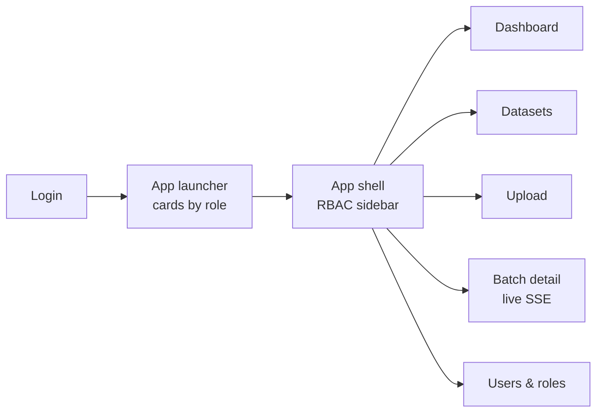
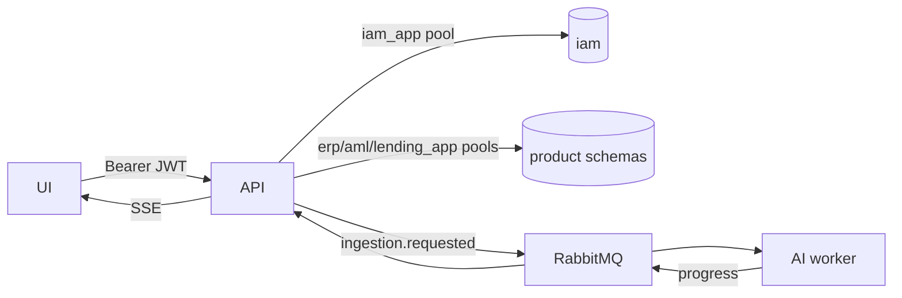

# WorkDone

Short log of what is built. Details → [DB_GUIDE.md](DB_GUIDE.md) · reasons → [Decisions.md](Decisions.md)

---

## 2026-10-31 · Smart Assistance (chat) ✅

**Built**
- **Database (`db/07_smart_assistance.sql` + template `_assistant.sql`):**
  - 9 allowlisted tools: Lending summary, details and trend; ERP payables ageing, overdue by supplier and payment details; AML alert summary, alert details and case details
  - the result contract from docs_ai/02, a record of every tool run, an audit row per question, and per-user conversation state
- **Backend (`app/assistant/`):**
  - the LangGraph graph from docs_ai/02: normalize → catalog → Groq plan → validate → clarification / tool → grounded answer → audit
  - `POST /api/apps/{app}/assistant/chat`
- **Frontend:** the Smart assistance page replaces the placeholder. It has suggested questions, a chat thread, KPI figures, supporting rows, and a sources line on every data answer (period, filters, definitions, result reference).

**Verified**
- DB assertions in `tests/test_all.sql`: hand-checked ageing numbers, permissions, conversation ownership, grants
- 34 backend tests (scripted-Groq graph routing, the HTTP endpoint against the real tool functions)
- Real Groq (`gpt-oss-120b`) questions over HTTP on a test copy of the DB

**Not yet done**
- **Shared DB:** `07_smart_assistance.sql` must be applied by the host (see DB_GUIDE)
- **Later steps:** report configuration through chat (docs_ai step 6) and RAG (step 7)
- **Groq free tier:** 8k tokens/min allows roughly 3 questions per minute

---

## 2026-10-31 · AI ingestion worker ✅

**Built** (`worker/`, run with `python -m ai_worker`; details in [worker/README.md](../worker/README.md))
- **Queue:** consumes `ingestion.requested` and reports on `<app>.progress`, using the same topology and statuses as the API, so every message passes `sp_update_batch_status`
- **Formats:** CSV (encoding and delimiter sniffing, ragged rows flagged), Excel (`.xlsx`/`.xls`, every sheet, header row found under title rows), JSON (arrays, wrapped arrays, JSON Lines; nested fields flattened)
- **PDF:**
  - pages with embedded text are read natively
  - scanned pages, and scanned images inside digital pages, go to PaddleOCR
  - both rebuild table rows or label/value forms the same way
- **Writes:** `raw_record` (COPY), `validation_issue` and a `PROPOSED` `mapping_version` in one transaction, as `<app>_app`
- **Mapping:**
  - order: aliases + types → local `bge-small-en-v1.5` → Groq, used only for unclear fields
  - Groq gets masked samples only, and its reply is schema-checked against an allowlist
- **Reliability:**
  - idempotent: a redelivered job writes nothing twice
  - temporary errors are retried with backoff and then dead-lettered
  - a bad file becomes `FAILED` with a user-safe message

**Verified**
- 36 tests pass: CSV ingestion, PDF/OCR routing, mapping layers, Groq validation, ack/retry decisions
- One test runs against the real schema built from `db/*.sql`, as `erp_app`: COPY, grants, the redelivery check, and every status applied through `sp_update_batch_status`

**Not yet verified**
- Against a live RabbitMQ broker
- With the real BGE and PaddleOCR models (the tests use stand-ins)

---

## 2026-10-31 · Frontend UI (React + Vite + Tailwind) ✅



**Built** (`frontend/`)
- **Look:** black and white design tokens, light/dark/system theme with no flash on load, Inter font bundled locally
- **Login:** brand panel on desktop; clear messages for wrong password, locked account and disabled account
- **Launcher:** one card per app the user has a role in, with role badges and staggered animation
- **Sidebar:**
  - collapses and expands with a spring animation (button or Ctrl+B); the choice is remembered
  - icon rail with tooltips when collapsed, sliding active highlight, animated sub-menus
  - app switcher at the top; a slide-in drawer on mobile
- **Pages:** dashboard (upload stats + recent uploads), datasets (filter, search, table on desktop and list on mobile)
- **Upload:** drag and drop, type and size checks, real upload progress bar, duplicate files open the existing batch
- **Batch detail:** progress stepper, live SSE progress and timeline, record breakdown bar, commit with confirm step (reviewers only)
- **Users & roles:** search, add user, roles dialog that saves only what changed, enable/disable for super admins
- **RBAC in the UI:** sidebar, buttons and routes follow the user's permissions; a typed URL to a forbidden page shows "no access"
- **Not built yet:** Mapping, Data quality, Reports, Templates and Assistant show an honest "not available yet" screen, not fake data

**Verified in the browser**
- Signed in as analyst, reviewer, app admin and viewer (`@azentio.ai`)
- Full run: upload → the worker runs through RabbitMQ → live SSE → reviewer commits (5 accepted, 1 rejected)
- Both themes, desktop and 375 px mobile
- `npm run build` is clean; lint has 0 errors and 17 style warnings

**Run**
```powershell
cd frontend; npm install; npm run dev     # http://localhost:5173 (proxies /api to :8000)
```

---

## 2026-10-31 · Backend API (FastAPI) ✅



**Built** (`backend/`, guide → [API_GUIDE.md](API_GUIDE.md))
- **Auth:** login, refresh with rotation (httpOnly cookie), logout, change password
- **SSO:** dashboard cards, select app (returns sidebar + permissions)
- **Admin:** list/create users, assign/revoke roles, enable/disable users
- **Upload:**
  - file streamed to disk while hashing
  - stored by content hash, so identical files are kept once
  - size limit and real file-signature check
  - duplicate upload returns the existing batch
  - message queued for the AI worker
- **SSE progress:** live events plus replay via `Last-Event-ID`, heartbeat, closes when the session ends
- **Commit:** endpoint with maker-checker
- **Broker:** RabbitMQ topology with a dead-letter queue, plus an in-process fallback for dev and tests
- **Worker contract** for the ML teammate: in API_GUIDE.md

**Verified:** 14 end-to-end tests against a real uvicorn server and the real DB pass, and re-runs pass too.

**RabbitMQ:**
- 4.4.0 installed locally
- the same 14 tests also pass through the real broker (vhost `studio_test`)
- an illegal transition lands in `ingestion.dead`
- progress is applied in order (single-active-consumer queue, prefetch 1)

**Not yet done**
- RabbitMQ runs as a user process, not a Windows service. The service failed with error 1067 and has been removed, so start the broker with `scripts/start-rabbitmq.ps1` after each reboot.
- Mapping, validation and template endpoints
- React UI

---

