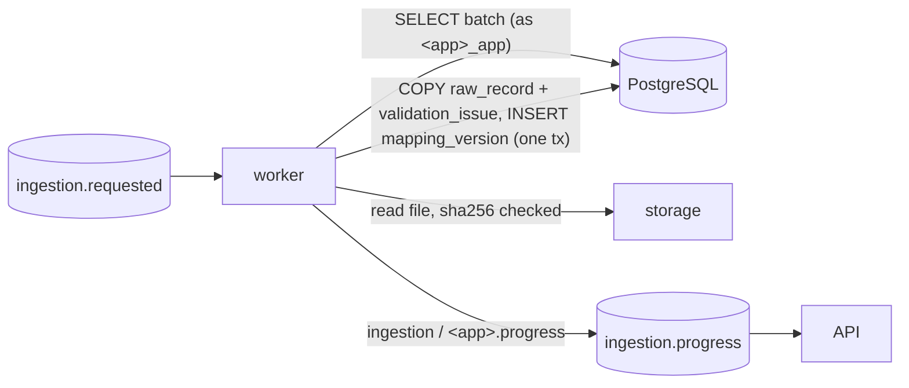

# AI ingestion worker

Implements the worker side of [API_GUIDE § AI worker contract](../docs/API_GUIDE.md#-ai-worker-contract-for-the-ml-side).
It replaces the fake worker in `backend/scripts/e2e_flow.py`.



## Run

```powershell
cd worker
python -m venv .venv; .venv\Scripts\pip install -r requirements.txt -r requirements-ml.txt
copy .env.example .env          # optional: GROQ_API_KEY, tuning. DB/RabbitMQ come from db/.env + backend/.env
.venv\Scripts\python -m ai_worker
.venv\Scripts\python -m pytest -q   # no broker/model/network needed
```

`test_repository_pg.py` also runs against the built DB when `db/.env` and `IAM_APP_PASSWORD` are available;
otherwise it is skipped.

## What a job does

| Step | Status sent (`progress_pct`) | Notes |
|---|---|---|
| Load batch | – | `ingestion_batch` row is the source of truth (file type, `storage_uri`, `sha256`). Batch already past `EXTRACTING` → job skipped |
| Read file | `EXTRACTING` 5 | path must be inside `STORAGE_DIR`; checksum must match |
| Parse | `EXTRACTING` 5–60 | CSV, Excel (every sheet), JSON, PDF. e.g. "OCR on scanned page 3 of 10" |
| Suggest mapping | `EXTRACTING` 65 | alias → BGE → Groq (below) |
| Save | `EXTRACTING` 85 | records + issues + proposal in one transaction |
| Done | `MAPPING_REVIEW`, or `NEEDS_REVIEW` if any record has an issue | |
| Bad file | `FAILED` + `error` | job acked (retrying can't help) |
| Temporary error | `EXTRACTING` "retrying…", then `FAILED` | re-queued with `x-attempt`; after the last attempt it goes to `ingestion.dead` |

Only the statuses of the batch state machine are used, so every message passes `sp_update_batch_status`.

## Output

- **`raw_record`:** one row per record, with `extraction_method` set to `csv`, `excel`, `json`, `pdf_text` or `ocr`.
  - `source_location`: `{"row"}` · `{"sheet","row"}` · `{"path","index"}` · `{"page","table","row","bbox"}` · `{"page","form","bbox"}`
  - `confidence`: the mean OCR score; NULL for exact sources
  - `target_entity`: the suggested domain table
  - `state`: `PENDING`, or `NEEDS_REVIEW` when the record has an extraction issue
  - `normalized_fields` stays NULL; it is filled after a person approves the mapping
- **`validation_issue`:** extraction problems (`EXTRACTION_RAGGED_ROW`, `EXTRACTION_LOW_CONFIDENCE`, …)
- **`mapping_version`:** version 1, `PROPOSED`, `created_by` NULL. `mappings` items:
  `{source_field, target_entity, target_field, transform, confidence, rationale, method, needs_review, candidates}`

## Mapping

1. **Profile** each field: inferred type, date format, masked samples (`LN-1001` → `XX-9999`; enum-like values such as statuses and currencies are kept).
2. **Entity:** the domain table whose fields the file covers best ([`mapping/catalog.py`](ai_worker/mapping/catalog.py) mirrors `db/05_domain_tables.sql`; a test keeps them in step).
3. **Per field**, first match wins:
   - **alias:** a single alias match with a compatible type
   - **BGE:** `bge-small-en-v1.5` cosine ≥ `BGE_ACCEPT` and a lead ≥ `BGE_MARGIN` over the next field
   - **Groq:** used only for the fields still unclear, all in one call, with masked data only. The reply must match a strict schema and name only allowed fields; anything else is dropped.
4. **Fallback:** if Groq is off or fails, the best local guess is kept and flagged `needs_review`.
5. **One field per target:** a target is never given to two fields; the weaker field is left unset.

## PDF routing

- **Page with embedded text** (at least `PDF_MIN_TEXT_CHARS`): native words are used. Large images on the page that have no text layer over them are OCR'd separately.
- **Page without text:** the whole page is rendered at `OCR_DPI` and OCR'd with PaddleOCR. PaddleOCR is loaded on first use only.
- **Both kinds** go through the same layout step ([`parsers/layout.py`](ai_worker/parsers/layout.py)):
  1. words are grouped into lines and cells
  2. the header row sets the columns
  3. repeated headers, totals and stray lines are dropped, and wrapped cells are joined
  4. a table can continue on the next page without a header
  5. pages with no table give one label/value form record
